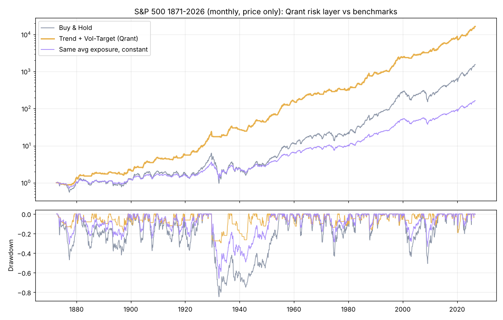

# 04 · 验证报告（开发阶段）

> 验证日期 2026-10-20。原则：只报告实际跑出来的数字；回测不代表未来。

## 一、单元测试（11 项全部通过）
`python -m pytest tests -q`

| 测试 | 验证内容 |
|---|---|
| 无前视 | 篡改未来价格，过去的信号与风控仓位完全不变（全部 5 个策略 + 风控层） |
| 次日开盘成交 | 第 t 天信号 → 第 t+1 天开盘价 ×(1+滑点) 成交，100 股整手 |
| 成本 | 最低 5 元佣金；股票卖出加收 0.05% 印花税，ETF 免；买入不收印花税 |
| 涨停 | 开盘涨停买入失败，次日才成交 |
| 波动率目标 | 任何情况下仓位 ≤ 100%（不加杠杆） |
| 回撤熔断 | 连续下跌中触发清仓，总亏损被限制在约阈值附近 |
| 仓位计算器 | 按风险 / 按上限两种约束的股数正确 |
| 组合 | 权重和 ≤ 1，单资产 ≤ 上限；风控组合回撤小于等权持有 |
| 稳健性工具 | Walk-Forward 折数与样本外长度、DSR ∈ [0,1]、蒙特卡洛输出 |
| CSV 导入 | GBK 编码中文表头可正确识别 |

## 二、真实数据验证：标普500 1871–2026（月度，价格指数，不含分红）

默认风控（波动率目标 15% + 自身趋势过滤）+ 两种策略，**所有区间全部通过 PRD v1.1 验收**：

| 区间 | 策略 | 买入持有 年化 / 最大回撤 / 卡玛 | **Qrant 风控** 年化 / 最大回撤 / 卡玛 | 同仓位基准 卡玛 |
|---|---|---|---|---|
| 1871–2026 | 10月均线 | 4.9% / −84.8% / 0.06 | **6.5% / −29.6% / 0.22** | 0.05 |
| 1871–2026 | 多周期动量 | 4.9% / −84.8% / 0.06 | **5.9% / −20.8% / 0.28** | 0.05 |
| 1928–1945（大萧条） | 多周期动量 | −0.1% / −84.8% / 0.00 | **7.2% / −20.8% / 0.34** | 0.02 |
| 1990–2026 | 多周期动量 | 8.9% / −50.8% / 0.17 | **7.2% / −14.4% / 0.50** | 0.17 |
| 2000–2026 | 10月均线 | 6.5% / −50.8% / 0.13 | **7.4% / −19.2% / 0.39** | 0.13 |

**结论**：最大回撤普遍降低 60%–75%；风险调整后收益（卡玛）是买入持有的 2.5–4 倍，且显著高于“同等平均仓位”基准，说明优势来自**择时避险**，而不只是仓位低。
注意：牛市主导的区间（如 1990–2026）年化收益略低于买入持有 —— 这是“保险费”。

## 三、模拟市场压力测试（20 条随机路径，类A股：年化≈5%，最大回撤≈−60%）

| 策略（默认风控） | 最大回撤 中位数 持有→风控 | 卡玛 中位数 持有 / 风控 / 同仓位 | 回撤降低的路径占比 | 完全通过验收占比 |
|---|---|---|---|---|
| 多周期动量 | −59% → **−23%** | 0.08 / **0.17** / 0.08 | **100%** | 55% |
| 均线趋势 | −60% → **−26%** | 0.08 / **0.15** / 0.08 | **100%** | 60% |
| 唐奇安突破 | −62% → **−22%** | 0.07 / **0.12** / 0.07 | **100%** | 65% |

**解读（诚实版）**：在“没有真实趋势规律”的随机市场里，系统**每一条路径都降低了回撤**（这是风控层的确定性作用），但只有约 6 成路径能在卡玛上战胜同仓位基准 —— 择时优势依赖真实市场中的趋势持续性。这正是系统内置“验收判定”的意义：在你自己的标的上实测，而不是盲信。

## 四、多资产组合（6 只 ETF，10 条模拟路径中位数）

| | 年化 | 最大回撤 | 卡玛 |
|---|---|---|---|
| 等权买入持有 | 7.4% | −34.5% | 0.19 |
| **Qrant 风控组合**（反波动率 + 动量过滤 + 10% 目标波动） | 3.8% | **−11.7%** | **0.33** |

组合牺牲了部分收益换取约 2/3 的回撤降低；希望收益更高可把“组合目标波动”调到 12%–15%。

## 五、校准过程中做出的设计决定
1. **ATR 止损默认关闭**：消融实验中它在宽基上增加打脸交易、降低卡玛；个股可开启。
2. **决策频率默认每周**：多周期动量换手从 ~450 笔降至 ~200 笔，卡玛基本不变；清仓信号仍次日立即执行（“出场快、进场慢”）。
3. **组合调仓阈值 5%**：较 2% 减少约 37% 交易，卡玛略升。

## 六、未能在开发环境完成、需在你本机完成的验证
开发环境无法访问东方财富/新浪行情接口，**A股真实数据回测需在本机运行**：打开「策略回测」页，系统会对每次回测自动给出验收结论（是否同时战胜买入持有与同仓位基准）。

## 七、A股真实数据验证（2026-10-21 更新）

第六节所说的本机验证已完成，过程中发现并修复了两处数据问题，详见 `docs/05_研究改进与自动化_v1.2.md`：
1. 份额折算未处理（510500 2015-04-15、513100 2022-01-14）→ 已自动修正；
2. 新浪回退数据未复权（分红被当成下跌）→ 已按新浪复权因子前复权。

数据修正后的最终结果（`reports/A股验证报告_20261021_2209.md`，6 只 ETF × 4 策略，2013 年起）：
- 验收通过率 **67%（16/24）**；回撤降低中位数 56%；
- 随机择时检验显著（p < 0.05）的 10/24 组，集中在创业板、黄金、国债；沪深300、中证500、纳指上不显著；
- 多资产组合：风控组合最大回撤 −12.3%（等权持有 −27.5%），但“配置不择时”卡玛 0.93 高于风控组合 0.65。

早期报告（21:20 的 78%、21:30 的 62%）基于有问题的数据，仅作为过程记录保留。
